<h1 align="center">Fields</h1>

<strong>让一群人和一群Agent围绕同一份上下文，在数字工作空间与物理现场持续协作。</strong>

<em>Many minds. One shared context.</em>

Fields 是一个 AI 原生协作空间。个人在 Home 中与 AI 工作，团队在 Room 中共同推进项目。Agent 以具名成员身份参与，使用可配置的执行能力完成工作，并在需要现场输入时通过物理终端与人沟通。

## 快速导航

| 产品与使用场景 | 功能、实现与演进 |
| --- | --- |
| [为什么做 Fields](#fields-section-01) | [功能一览](#fields-section-07) |
| [Fields 为谁而做](#fields-section-02) | [权限、恢复与可靠性](#fields-section-08) |
| [怎样判断协作有效](#fields-section-03) | [技术架构](#fields-section-09) |
| [产品设计与取舍](#fields-section-04) | [验证与演进](#fields-section-10) |
| [工作空间与交互](#fields-section-05) | [团队采用与反馈](#fields-section-11) |
| [使用场景](#fields-section-06) | |

## 为什么做 Fields

### 用户正在发生的变化

团队成员开始把研究、写作、开发、分析和运营工作交给 AI。每个人使用的工具、对话历史和执行环境各不相同，任务推进速度加快，项目中需要共享的信息和需要确认的结果也随之增加。

一位成员能够让 AI 产出报告或代码，其他成员仍要弄清它依据什么、做到哪一步、哪些部分可以继续使用。现场发生的新情况，也常常要经过人手动汇报才能进入数字任务。

Fields 聚焦这段协作过程，让工作在不同的人、Agent、工具和现场之间保持连续。

### 核心问题

| 用户遇到的问题 | 具体表现 | 产品需要改变的体验 |
|---|---|---|
| 同一个项目存在多份背景 | 每个人向自己的 AI 重新解释需求，资料更新后部分成员仍沿用旧版 | 团队能够识别当前依据、具体版本及更新内容 |
| AI 做完之后，工作难以接手 | 最终产物与原始讨论、修改要求、执行过程分散 | 其他成员能沿着同一段工作理解并继续推进 |
| Agent 的职责和能力难以持续维护 | 项目间反复复制提示词，更换执行工具时重新配置协作方式 | Agent 保持稳定身份，职责、能力和使用历史可持续管理 |
| 人离开屏幕后，任务等待输入 | Agent 需要现场确认，消息未被及时处理，口头回答缺少数字记录 | Agent 可以通过授权终端联系现场人员并获得回复 |
| 有效工作方式难以复用 | 新项目重复找资料、配 Agent、解释标准 | 团队可复用已有角色、资料、能力与交付经验 |

### 共同上下文的价值

产品的核心价值是让一次 AI 工作成为团队能够理解、判断、接手和复用的工作成果。

## Fields 为谁而做

### 目标团队

优先服务已经高频使用 AI、存在真实项目和重复交付需求的团队，包括创始人主导的小团队、软件与自动化交付团队、研究与内容团队，以及传统公司内部率先采用 AI 的业务小组。

识别目标用户时，重点看以下行为。

- 已经使用多个 AI 工具承担日常工作。
- 交付物需要由其他成员理解、修改、确认或继续使用。
- 同类项目重复发生，团队希望减少每次重新配置的工作。
- 项目资料、判断和方法集中在少数关键成员手中。
- 部分工作依赖现场人员提供最新信息或作出判断。

### 用户角色

| 角色 | 主要目标 | 核心动作 |
|---|---|---|
| 项目负责人 | 让项目持续推进，知道哪些结果可用、哪些问题等待处理 | 建立 Room，明确目标，组织成员，委托、追问和确认 |
| 协作成员 | 快速理解背景，完成工作并接续其他人的产物 | 补充资料、回复讨论、调用 Agent、修改和交接 |
| 公司管理员 | 使成员、执行能力和共享资料处于可用状态 | 管理成员与 Agent，配置能力、权限和物理终端 |
| 现场参与者 | 以低操作成本向项目提供当前情况和判断 | 查看来电、接听、语音回复、拒接或挂断 |

Agent 在产品中具有自己的名称、职责、能力配置和参与方式。人类成员能够向它委托工作，也能够理解它正在做什么、为何需要帮助以及结果如何继续使用。

### 关键用户需求

- 作为项目负责人，我希望把目标和资料放进一个 Room，让人和 Agent 基于同一份背景开展工作。
- 作为协作成员，我希望沿着讨论和引用直接接手产物，减少重新询问前情的时间。
- 作为 Agent 使用者，我希望持续维护它的职责和能力，并在更新执行工具时保留协作关系。
- 作为离开桌面的参与者，我希望通过身边的终端回应 Agent，让任务能够继续推进。
- 作为团队负责人，我希望下一次类似项目能沿用已经有效的配置和方法。

## 怎样判断协作有效

### 产品目标

| 目标 | 用户可感知的变化 | 观察证据 |
|---|---|---|
| G1 · 共享工作依据 | 成员能够找到项目资料并识别当前使用的版本 | 对话和执行使用明确的资料引用 |
| G2 · 工作可以接续 | Agent 的结果回到原有讨论，其他成员能够继续处理 | 人类确认、修改、引用或承接执行结果 |
| G3 · Agent 持续承担角色 | 多次任务中保持一致的协作身份，职责与能力可调整 | 同一 Agent 在多个任务中重复使用 |
| G4 · 接入现场输入 | Agent 能联系物理终端，取得人的语音回答并继续工作 | 一次现场语音往返进入原任务上下文 |
| G5 · 经验逐步积累 | 相似项目启动时可以复用已有配置和资料 | 另一项目或另一位成员实际采用已有资产 |

### 核心价值事件

**软件协作价值事件**发生在一次 Agent 工作返回 Room，并被人类成员明确采纳、修订或用于下一步工作时。

**物理协作价值事件**发生在 Agent 通过终端获得现场回复，并将其用于继续处理原有任务时。

对这两类事件，统计时应保留触发消息、执行或通话标识、结果与后续动作之间的关系。用户的确认可以通过自然语言表达，计量方式需要能识别其对应的具体工作。

### 产品验证指标

| 指标 | 建议统计口径 | 用途 |
|---|---|---|
| 周有效协作 Room 数 | 一周内至少完成一次软件协作价值事件的去重 Room 数 | 衡量产品是否承载真实工作 |
| 首次价值达成时间 | 从创建首个 Room 到首次完成价值事件的时长 | 衡量初始配置和使用门槛 |
| 跨成员接续率 | 结果被发起者之外的人类成员继续使用的执行次数，占已返回结果的执行次数比例 | 衡量团队协作价值 |
| Room 持续使用率 | 本期有效 Room 在下一观察周期继续发生价值事件的比例 | 衡量连续使用 |
| 跨项目资产复用率 | 新项目使用已有资料、Agent 配置或能力资产的比例 | 衡量经验积累 |
| 现场语音闭环完成率 | 发起呼叫后完成接听、有效转写和原任务继续推进的比例 | 衡量物理接入价值 |
| 端到端可靠性 | 执行失败率、结果回传失败率、恢复成功率及耗时 | 衡量可持续交付能力 |

指标目标值在首批真实项目建立基线后确定。演示、内部测试和真实用户使用分别记录，结果按任务类型及参与方式分组分析。

## 产品设计与取舍

### 核心体验

| 范围 | 交付目标 |
|---|---|
| Home 与 Room | 提供个人工作和团队协作两种清晰语境 |
| 人与 Agent 的共同讨论 | 支持成员加入、提及、回复、引用、追问和结果接续 |
| 共享上下文 | 管理项目资料、文件版本及可访问范围 |
| Agent 身份与能力 | 维护职责配置、参与策略及执行器绑定 |
| 执行与交付 | 让任务的进度、异常和结果回到原协作空间 |
| 物理语音接入 | 让 Agent 经授权终端向现实中的人获取输入 |
| 跨端参与 | 通过桌面完成主要工作，通过移动端及时参与 |

### 后续演进

Agent 配置的分支、合并和回滚，公司级共同记忆的治理，以及由角色、流程、验收标准和资料组成的 Cell Kit，属于后续持续完善的能力。更多执行器、外部协作连接，以及摄像头、传感器和物理动作设备的接入，依据实际场景推进。

### 关键设计取舍

| 设计选择 | 用户收益 | 产品需要处理的代价 |
|---|---|---|
| 用自然语言承接委托与判断 | 团队沿用熟悉的讨论方式，表达模糊目标和修订要求 | 系统需要识别来源、引用和工作状态，必要时澄清歧义 |
| 将 Agent 身份与执行能力分离 | 用户可以长期维护同一协作成员，并更新底层能力 | 产品需要管理绑定、授权、可用状态与切换过程 |
| 保留 Home 与 Room | 个人探索和团队共享各有合适空间 | 分享时需要明确内容、对象和权限 |
| 围绕同一份项目资料协作 | 降低重复解释和信息不一致的成本 | 需要处理资料更新、版本冲突和访问范围 |
| 允许 Agent 主动参与 | Agent 能及时提出问题、补充信息和获取现场反馈 | 需要控制触发条件、打扰程度与连续调用 |
| 将物理终端纳入协作 | 离开桌面的人员仍能提供输入 | 需要处理来电接受、设备离线、语音错误和任务恢复 |

## 工作空间与交互

### 工作空间

| 工作空间 | 用户在这里做什么 | 主要内容 |
|---|---|---|
| Home | 独立研究、起草、执行和探索 | 个人会话、分支、资料和执行状态 |
| Room | 围绕一项工作共同讨论和交付 | 人与 Agent、消息、共享资料、执行结果与后续动作 |
| 成员与能力设置 | 准备可以参与工作的角色和能力 | Agent 职责、指令、执行器、模型和能力资产 |
| 文件与资产空间 | 查找、维护和复用已有内容 | 文件版本、引用、共享范围及已发布能力 |
| 物理终端设置 | 将现场设备接入组织 | 配对、设备名称、连接状态和授权管理 |

### Room 主工作面

Room 将持续讨论放在界面中心。用户能够直接看到当前空间、参与成员、消息来源和输入入口，通过消息进入相关资料、执行过程和交付物。

- **导航区域**帮助用户切换 Home、Room 和全局对象。
- **消息主区域**承载讨论、Agent 回复、执行反馈和人的判断。
- **输入区域**支持文本、附件、提及、回复和资料引用。
- **辅助区域**按需展示线程、上下文、成员或对象详情。
- **全屏阅读区域**用于长文档、产物和需要较大空间的内容查看。

用户打开辅助信息后，应能返回原消息位置。查看资料、参与线程和检查产物时，原有讨论上下文保持可识别。

### Agent 的用户可见状态

用户应能理解 Agent 当前是在准备、等待、执行、请求输入、交付结果，还是遇到异常。状态展示围绕正在发生的工作展开，详细过程按需查看。

同一段工作需要能够回答四个问题。

1. 谁在做这件事，因哪条消息开始。
2. 当前进展是什么，是否需要人介入。
3. 结果或异常在哪里。
4. 用户下一步可以怎样继续。

## 使用场景

以下场景说明产品如何承接真实工作，可作为产品演示和项目回顾的叙述线索。

### 团队共同完成客户方案

**起点**是项目负责人已有客户需求，需要同事与研究 Agent 一起完成方案。

| 步骤 | 用户行为 | 产品响应 | 完成条件 |
|---|---|---|---|
| 建立项目语境 | 创建 Room，邀请同事和研究 Agent | 显示成员、职责与能力准备状态 | 参与者可以进入同一空间 |
| 提供共同依据 | 上传客户资料，说明目标和交付要求 | 资料可引用，消息保持来源 | 成员能够访问获准资料 |
| 发起委托 | 提及 Agent，要求整理研究结论 | Agent 承接工作，遇到缺口时澄清 | 执行与原消息建立关联 |
| 推进讨论 | 同事补充限制条件和新资料 | 新信息进入相应讨论，Agent 能继续处理 | 用户理解本轮工作采用了哪些变化 |
| 检查结果 | 打开产物，询问依据，要求修改 | 保持产物与原任务关系，承接修订 | 修订结果返回同一协作语境 |
| 完成交接 | 另一位同事使用结果继续撰写方案 | 能够定位背景、资料和当前产物 | 形成跨成员接续事件 |

### 个人探索进入团队协作

用户先在 Home 中尝试不同方案，选择适合团队讨论的结论和资料，再进入目标 Room 分享。分享过程应明确传递哪些内容、引用哪个版本、由哪些成员可见。

团队成员可以基于分享内容继续讨论和委托 Agent。分享设计关注内容选择、来源引用和访问范围三个方面。

### Agent 获取现场信息后继续工作

**起点**是团队正在准备一次客户演示，Agent 需要确认现场设备和物料是否准备完成，负责人当前离开电脑。

1. Agent 在当前任务中识别信息缺口，形成明确问题。
2. Agent 选择已配对且具有访问权限的现场终端，发起呼叫。
3. 终端显示呼叫者和沟通目的，现场人员选择接听或拒接。
4. 接听后，终端播放 Agent 的问题，现场人员按键录音并提交回答。
5. 语音被转写，返回当前 Agent 的工作上下文。
6. Agent 根据回答继续推进任务，必要时继续提问，并向原 Room 说明进展。

**完成条件**是现场回答被用于原任务的下一步。拒接、无人接听或设备离线时，Agent 应将问题呈现为待获取输入，用户可以改用 Room 回复或重新联系。

### 复用已有工作能力

团队启动相似项目时，可以沿用已有 Agent、已发布能力和适用资料，检查职责及访问范围后开始工作。进一步的 Cell Kit 将把角色、任务方式、验收标准和资料模板组合成可重复使用的项目起点。

复用的价值通过下一项目的启动耗时、配置工作量和真实使用情况验证。

## 功能一览

Fields 的日常使用围绕个人 Home、团队 Room、Agent 成员和共同资料展开。用户通过对话推进工作，执行能力在背后完成任务，文件、结果和现场输入持续回到相应的协作语境中。

### Home 与 Room 组成的个人和团队工作空间

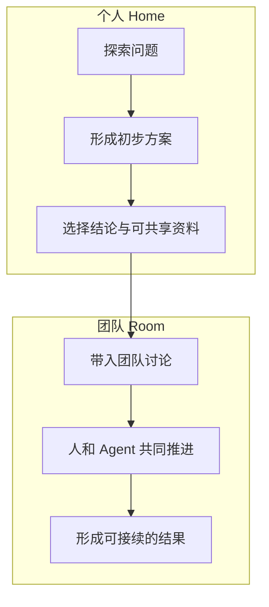

**Home 承载个人与 AI 的连续工作。** 用户可以在自己的会话中研究问题、起草内容、处理文件或执行任务，随后回到已有对话继续推进。会话历史、执行状态和个人工作资料共同构成后续工作的背景。搜索帮助用户重新找到过去的讨论，分支则保留围绕同一问题展开的不同尝试。

**Room 承载团队共同推进的一项工作。** 用户建立 Room，组织人类成员与 Agent，在同一条讨论中提供目标、补充资料、提出问题和接收结果。Room 把参与者、消息、引用和执行反馈放在一起，使团队可以沿着工作过程理解当前进展。

两种空间分别服务独立探索与共同协作。用户可以先在 Home 形成初步思路，再选择适合共享的结论或资料带入 Room。个人内容进入团队语境时，产品设计关注分享范围、目标空间和资料来源。从 Home 直接分享到 Room 的具体入口仍需确认。

用户通过导航切换工作空间，界面随之呈现对应的成员、讨论和资料。正在阅读的文件、相关线程或成员信息通过辅助区域展开，让用户在查看细节时保留对主讨论的定位。

### 人与多个 Agent 共同参与的项目讨论

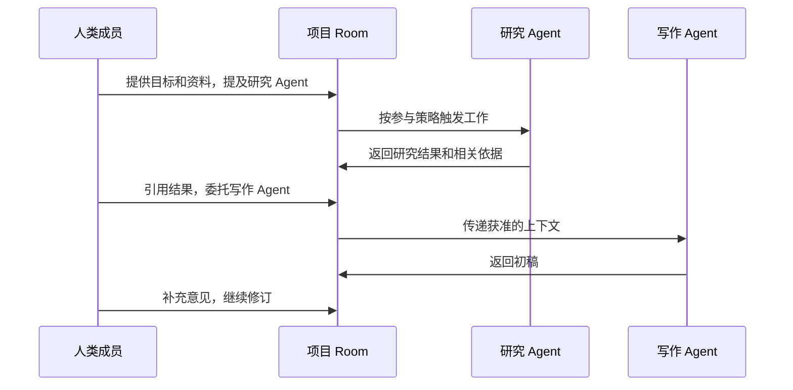

Room 将人类和 Agent 都作为具有名称与身份的参与者呈现。用户可以提及某位成员、回复已有消息、引用相关资料，并沿着同一段讨论继续追问。Agent 的回复关联到触发它的消息和执行过程，团队能够理解它在回应什么、做了什么。

Agent 的参与方式按 Room 配置，包含显式提及、直接回复以及自动参与策略。策略可以区分来自人类和 Agent 的消息，形成不同的协作节奏。例如，人类先向研究 Agent 提问，再由另一位成员或 Agent 基于研究结果继续处理。自动参与的范围通过具体策略表达。

多人协作时，用户可以补充限制条件、指出错误或要求修订，后续工作沿着相关消息和引用继续。Agent 需要额外信息时，可以在当前讨论中提出问题，让人类提供判断或补齐资料。

这种协作方式让角色分工直接体现在工作现场。研究、分析、写作或开发等 Agent 可以具有不同职责，人类保留目标设定和结果判断的位置，各方围绕可共享的工作依据接续推进。

### 对话线程、分支与回复版本

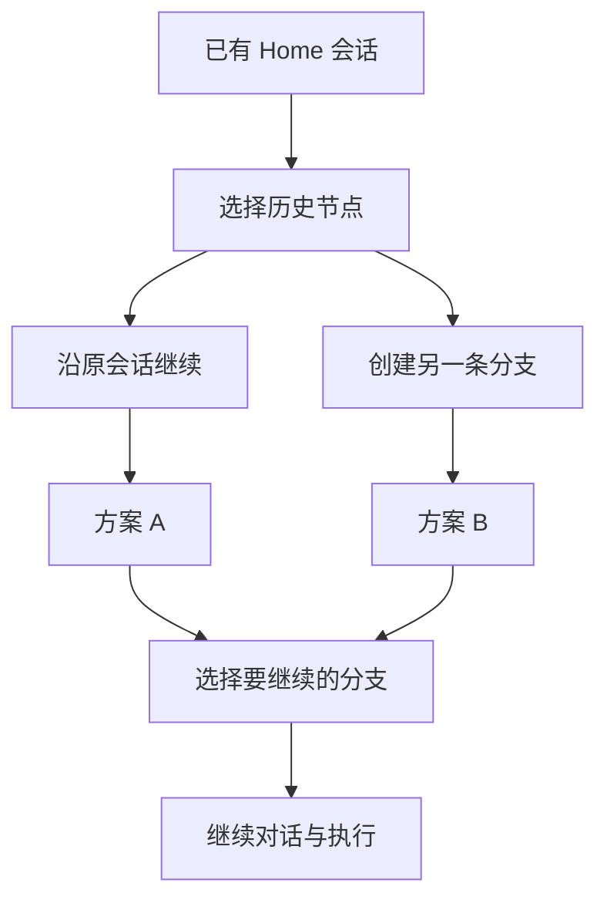

持续工作通常会产生多轮修改、不同方案和局部讨论。Fields 用线程、回复关系和版本选择组织这些变化。

| 能力 | 使用方式 | 对工作的帮助 |
|---|---|---|
| 消息回复与引用 | 围绕指定消息或资料继续讨论 | 保留问题、依据和后续回答之间的关联 |
| 局部线程 | 展开与某个问题相关的一组讨论 | 集中处理细节，同时保留其在 Room 中的位置 |
| Home 会话分支 | 从已有节点展开另一种尝试，或基于编辑后的输入继续 | 保留不同探索路径，方便回看和选择 |
| Agent 回复版本 | 查看重生成产生的回复版本及当前选择 | 识别本轮讨论正在采用的回答 |
| 会话搜索与历史 | 查找过去的工作并继续处理 | 减少重新输入背景的成本 |

产品将版本选择与原工作关联起来，使用户可以理解当前采用了哪条路径。后续成员也可以通过历史和引用找到一个结论的形成过程。

### 共同上下文、文件与工作产物

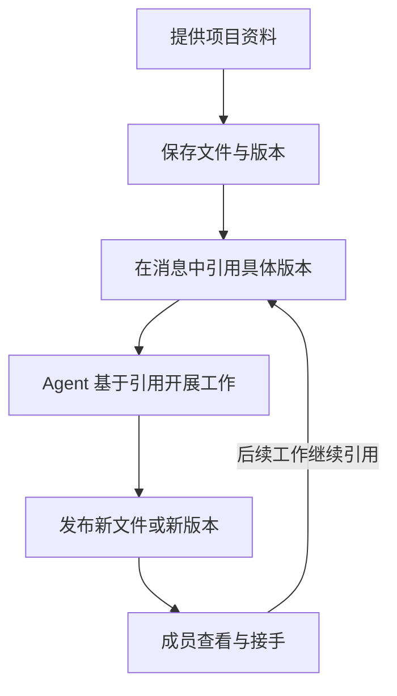

Fields 将讨论使用的资料和执行形成的产物组织为可以引用、更新和共享的文件。文件具有身份、版本和访问范围，Room 消息可以指向具体文件及其版本。

在实际工作中，成员先提供客户资料、项目说明或已有成果，再围绕这些内容讨论和委托 Agent。Agent 本次执行取得的资料与消息中的具体引用关联，后续资料更新后，团队能够区分此前讨论的依据与新版本。

| 内容 | 在产品中的组织方式 |
|---|---|
| 项目输入 | 通过文件、附件和消息引用进入讨论 |
| 当前资料 | 通过文件身份及当前版本定位 |
| 历史依据 | 保留已有版本和对应消息关系 |
| Agent 产物 | 发布为新文件或新版本，并关联原有工作 |
| 对外分享 | 通过可管理、可撤销的分享入口提供访问 |

其他成员可以打开 Agent 交付的内容，检查依据，提出修改，并继续引用结果。资料和产物因此能够在多轮工作之间保持连续，逐步形成团队可以接续使用的项目背景。

共享范围由成员与文件权限共同决定。更新、分享和引用过程中保留版本信息，让团队知道采用了什么资料，也为并发修改和历史回看提供基础。

### Agent 身份、职责与执行能力

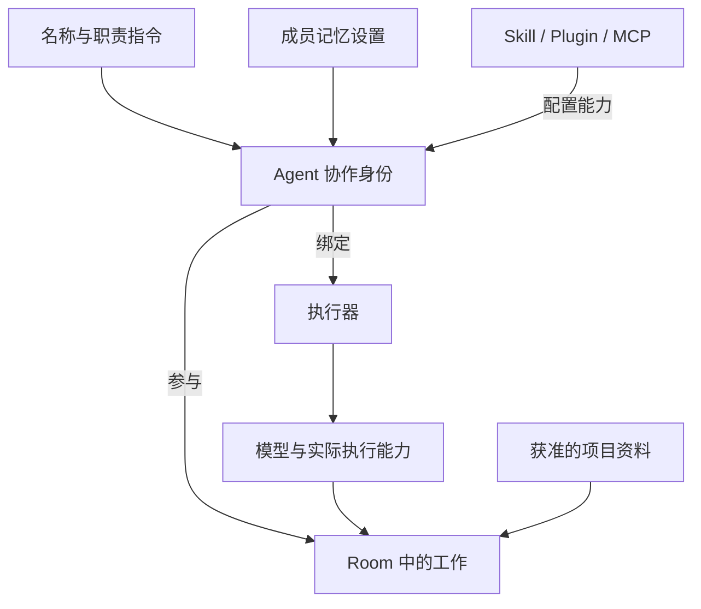

每个 Agent 具有自己的名称、描述和职责指令，可以配置准备状态与记忆设置，并作为成员进入 Room。团队面对的是能够持续承担某类工作的协作角色。

Agent 的配置分为相互关联的几部分。

| 配置 | 作用 |
|---|---|
| 身份与描述 | 让成员识别这个 Agent 及其用途 |
| 职责指令 | 表达工作范围、处理方式和沟通要求 |
| 执行器绑定 | 提供实际运行任务的能力 |
| 模型与推理配置 | 确定可使用的模型及相应运行选项 |
| Skill、Plugin、MCP 等能力资产 | 为成员安装可复用的技能和工具 |
| 记忆设置 | 管理成员记忆的启用及应用状态 |

产品分别维护协作身份、执行能力和项目资料。团队可以持续调整 Agent 的职责，同时管理它使用的执行器和能力资产。授权、配置、准备、切换和异常状态提供了可见反馈，使用户理解这个成员当前是否能够开始工作。

在更长期的产品设计中，Agent 的职责、指令和行为边界还可以通过版本、项目变体、合并和回滚持续演化。这个方向让团队逐步积累可维护的协作成员资产，完整的 Agent 配置版本治理仍属于演进方向。

### 从工作发起到结果接续的执行体验

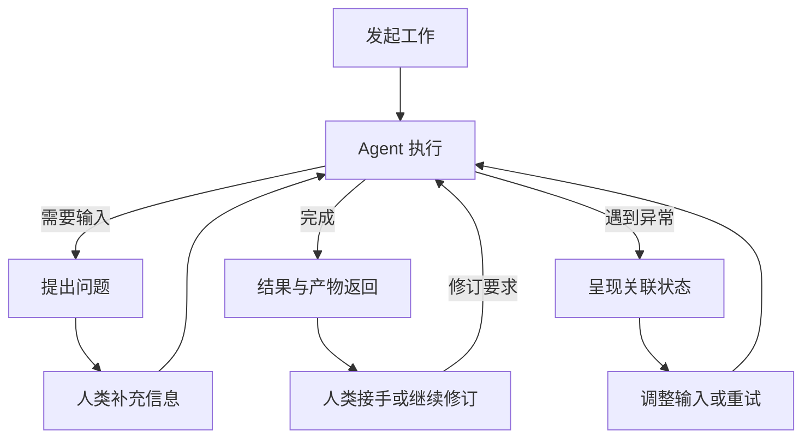

用户在 Home 或 Room 中发起工作后，产品将请求与成员、消息和执行过程关联。Agent 调用执行器开展任务，界面呈现相关进度、输入请求和结果，用户可以回到同一段工作继续处理。

执行过程中，人类可以提供补充信息或修改方向。Agent 的问题回到原协作语境，人类回答后，相关输入用于继续工作。执行结束时，文本回答和文件产物为下一轮讨论提供依据。

| 用户看到的情况 | 产品呈现的信息 | 可以继续采取的动作 |
|---|---|---|
| 等待或正在执行 | 当前执行状态及关联工作 | 继续讨论，或使用适用的中断操作 |
| Agent 请求输入 | 需要回答的问题和对应背景 | 提供资料、判断或修改要求 |
| 执行器需要配置 | 授权、模型或能力状态 | 恢复配置或选择可用能力 |
| 工作返回结果 | 回答、产物及相关来源 | 查看、追问、要求修订或交给其他成员 |
| 执行或回传遇到异常 | 与原工作关联的状态及错误 | 重试、调整输入或由人接手 |

运行状态与结果持久化帮助用户重新打开会话后继续理解工作。异步回传和恢复机制承担执行过程与产品界面之间的衔接，使完成的工作能够回到团队讨论中。

### 物理终端与现场语音协作

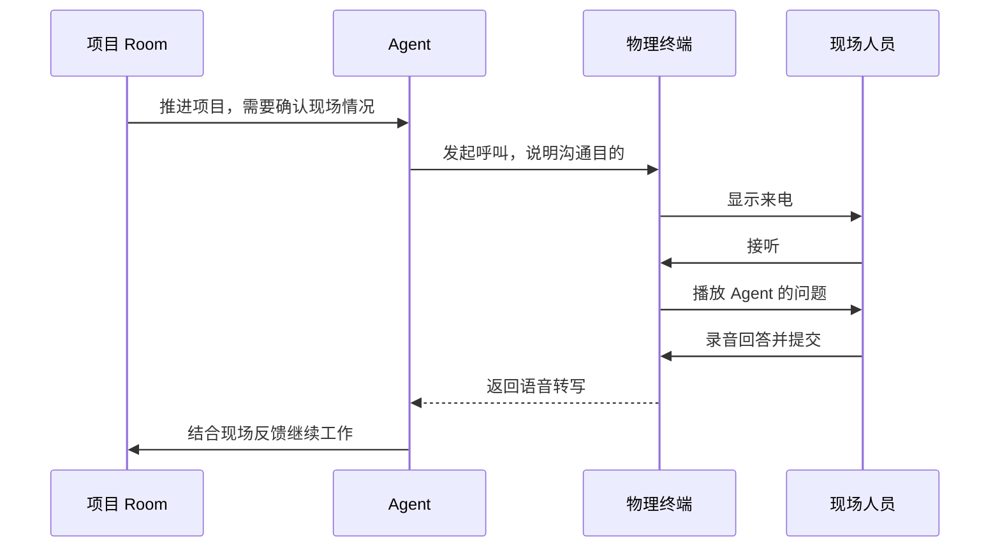

Fields 通过 Embodiment 将 Agent 的协作范围延伸到现实中的人。Agent 在推进数字任务时，可以联系已配对的物理终端，询问现场情况、获取判断或请求补充信息。语音回复转写后返回调用 Agent，成为原任务的后续输入。

**设备接入。** M5StickS3 终端首次连接时显示配对码，由公司 Owner 认领并命名。设备列表提供名称和连接状态，配对凭据保存在终端。普通断线后设备重连，管理者也可以轮换或撤销设备授权。

**主动联系。** Agent 通过工具获取可联系的终端，携带呼叫者名称和可选沟通目的发起来电。设备显示相关信息，现场人员用按键决定是否接听。调用方取得接通、拒接、未接听、离线或忙线等结果。

**现场交流。** 当前终端使用半双工语音轮次，先播放 Agent 的问题，再接收人的录音回答。设备上的 A 键承担接听、开始录音和结束提交，B 键承担拒接或挂断。问题通过语音合成播放，录音通过语音识别形成转写。

**回到原任务。** 每次语音交换关联具体通话和轮次，转写结果沿工具调用返回原 Agent。Agent 可以据此继续提问、处理当前任务，或把有关结论带回原 Room 的讨论。通话提供了现场输入进入数字工作的一条路径。

例如，团队准备客户演示时，Agent 可以向现场终端询问设备是否就绪。现场人员接听后说明当前情况，Agent 获得回答，再继续处理演示安排。这个例子说明物理接入与项目协作之间的关系。

| 状态 | 设备与调用方的信息 |
|---|---|
| 来电 | 呼叫者、可选目的以及接听或拒绝操作 |
| 播放问题 | 当前播放状态及后续录音阶段 |
| 录音与提交 | 按键控制的录音过程，提交后进入回复处理 |
| 转写返回 | 调用方收到本轮回答及相应结果状态 |
| 拒接、离线或无人接听 | 调用方取得明确联系结果，原任务可以据此继续处理 |
| 断线、录音为空或语音服务失败 | 返回相应结束或失败状态 |

PC 模拟器复用终端核心和显示场景，以浏览器音频和设备按键模拟辅助开发。实体终端验收、现场噪声表现及通话后的任务接续仍需验证。

### 记忆、能力资产与项目复用

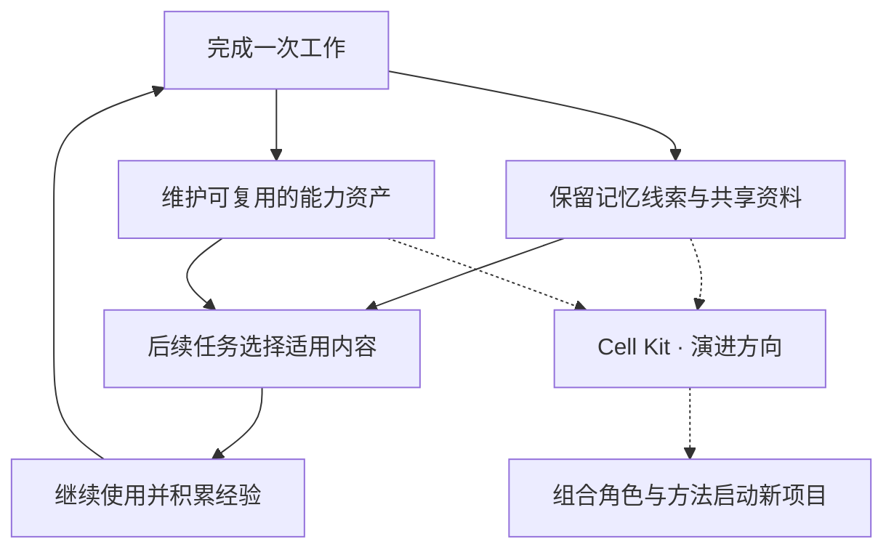

Fields 从成员记忆、共享文件和能力资产三个层面承接持续工作。

**成员记忆**随个人或 Agent 的持续使用保留工作线索，产品提供启用与应用状态。**共享文件**沉淀团队可以引用的资料与产物。**能力资产**将 Skill、Plugin 和 MCP 配置组织为可发布、可安装和可更新的版本。

团队开展后续工作时，可以沿用已有 Agent、适用资料和已发布能力，结合新项目调整职责与使用范围。这些配置和资料成为相似工作的起点。

长期设计中的 Cell Kit 会进一步将 Agent 角色、任务方式、交付模板、验收标准和项目记忆组织成一套可复用的工作组合。它关注一次有效做法如何被另一个成员、另一个项目或另一个团队采用。完整 Cell Kit 与 Agent 配置分支合并属于产品演进部分。

### 桌面、移动与通知

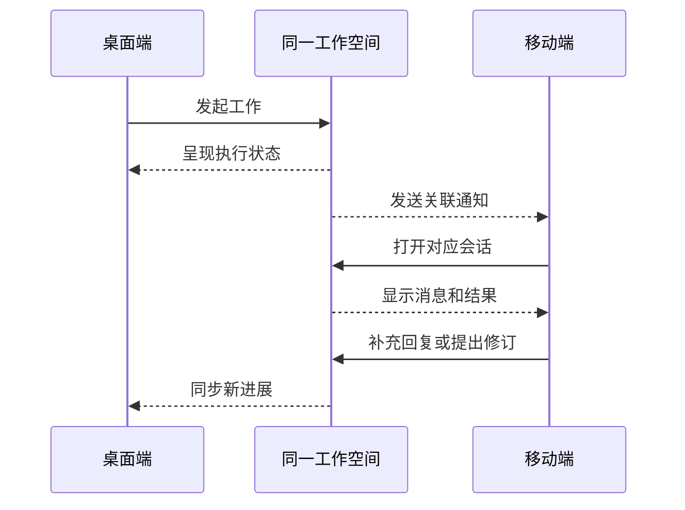

Windows 桌面端承载主要产品体验，包括 Home、Room、成员与能力设置、文件管理和需要较大空间的内容处理。移动 PWA 为已有用户提供 Home 和 Room 会话、图片消息、搜索及通知等参与入口。

用户在桌面发起工作后，可以通过手机查看消息、继续讨论和提供输入。通知关联到相应会话或工作位置，帮助用户在收到新进展后返回正确语境。成员身份、消息和引用关系沿用同一套产品数据。

手机端侧重正在发生的协作，注册、组织初始化、Room 创建和执行器配置等管理操作集中于桌面端。移动端采用在线访问方式，通过连接状态和重新同步承接网络变化。

### 周期性工作与运行记录

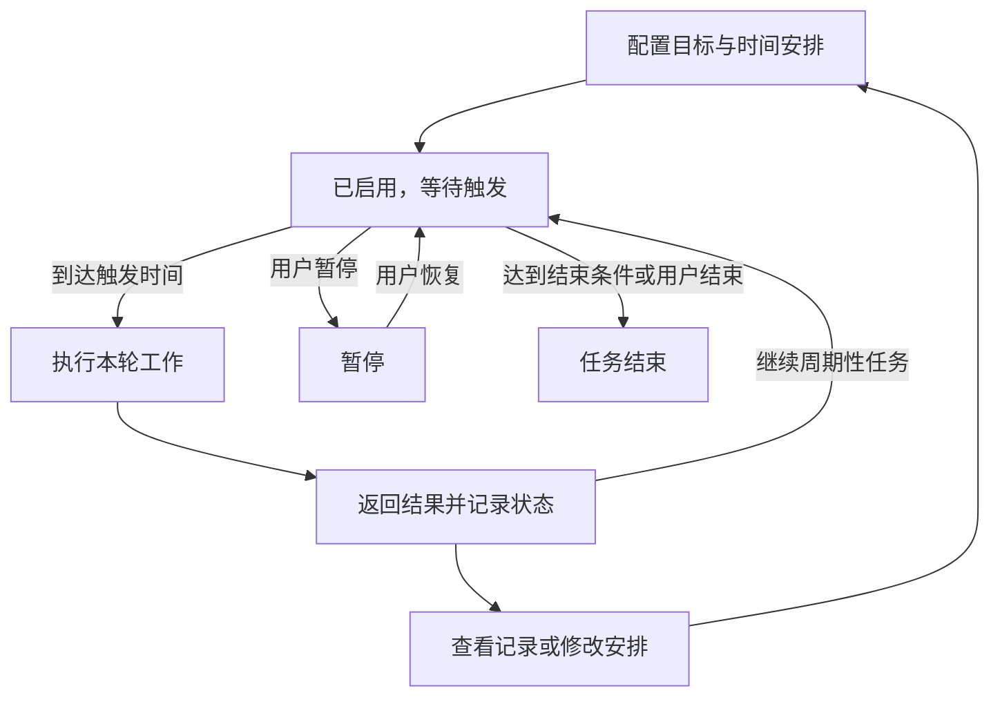

周期性工作把需要重复开展的任务保存为持续运行的安排。任务配置包含目标内容、触发时间、关联空间和执行次数等信息，用户可以查看运行记录，并按需修改、暂停、恢复或结束。

每次运行保留自身状态，包含等待、重试、成功、失败、错过或跳过等情况。用户可以据此了解任务执行进度，并使用立即运行等操作继续处理。

这类能力适用于重复的信息整理、定期检查和持续更新等工作。结果沿相应的工作关系返回，使长期任务能够与日常 Home／Room 协作保持联系。

## 权限、恢复与可靠性

### 身份与共享范围

| 对象 | 用户需要知道什么 | 产品要求 |
|---|---|---|
| Home 内容 | 属于谁，哪些内容已经分享 | 分享对象和范围可识别 |
| Room 内容 | 哪些人和 Agent 可以参与 | 成员关系及访问变化可理解 |
| Agent 配置 | 谁负责维护，修改何时生效 | 配置状态和修订信息可查询 |
| 文件与产物 | 引用哪一版，谁可以访问 | 版本、权限和分享状态一致 |
| 执行器 | 谁提供能力，当前是否可用 | 授权与使用状态可见，凭据保留在适当边界 |
| 物理终端 | 哪个组织的哪台设备，当前是否可联系 | 配对、连接和撤销状态可管理 |

### 连续性与恢复

同一操作被重复提交时，应尽可能维持一次明确的业务结果。多个成员同时修改时，应反馈冲突并提供继续处理路径。运行中断和网络恢复后，用户能够找到原有工作、已有产物和待完成部分。

Agent 的语音回答、执行结果与文件需要保留对应工作语境，避免用户在多个入口之间重新拼接前情。

### 性能与稳定性

| 体验 | 应测量的指标 | 观察场景 |
|---|---|---|
| 打开与切换 Room | 加载时间、状态恢复时间和错误率 | 使用规模明确的消息与资料集验证 |
| Agent 执行反馈 | 首次状态反馈、结果回传时延和失败率 | 按任务类型及执行器分组测量 |
| 多人协作 | 消息同步时延、冲突及重复处理情况 | 多成员同时操作及重连场景验证 |
| 物理通话 | 接通时间、播放等待、转写返回时间和失败原因 | 实物、真实语音服务及不同现场噪声条件验证 |
| 跨端访问 | 通知到达、定位正确率和重新同步时间 | 桌面与移动端联合验证 |

性能表现结合使用场景和基线测量记录。产品反馈需让用户知道当前是在等待系统、等待执行器，还是等待他人输入。

## 技术架构

技术架构围绕三个连续过程组织：团队在产品界面中协作，Agent 在独立执行环境中工作，现场人员通过物理终端提供输入。产品身份、共享资料、执行过程和设备连接各有明确职责，通过契约和事件保持关联。

### 总体架构

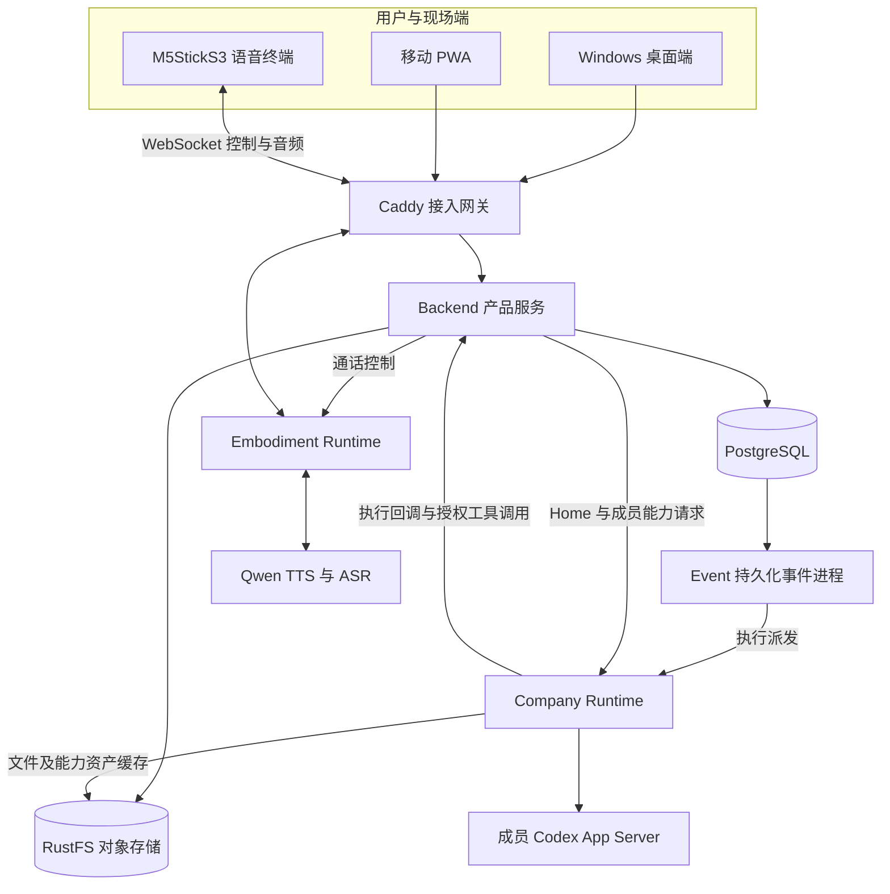

图中表示逻辑职责和主要通信关系。当前内部部署使用一个固定 Company 和一份持久化 Runtime 工作卷，Backend 与 Company Runtime 在同一后端容器内以独立进程运行，Event 与 Embodiment 具有独立进程入口。成员 App Server 由 Company Runtime 管理。部署形态和产品中的组织概念分别演进。

### 核心模块与职责

| 模块 | 主要职责 | 支撑的产品体验 |
|---|---|---|
| Frontend | React 共用产品界面、Electron 桌面外壳、移动 PWA | Home／Room、成员、文件和对话在多端保持统一语义 |
| Backend | 身份与权限、Company、Room、消息、Agent 配置、执行记录、文件元数据及能力资产管理 | 维护团队共同使用的产品状态和可追踪关系 |
| Company Runtime | 成员工作目录、App Server 生命周期、执行器凭据、Home 执行和 Room Agent 执行 | 让稳定的成员身份连接实际执行能力 |
| Event | 持久化事件派发、消费者执行、重试和定时工作 | 将长时工作从同步界面请求中解耦，支持失败后的继续处理 |
| Embodiment Runtime | 终端连接、通话状态、音频交换及语音服务调用 | Agent 与现实中的人完成语音往返 |
| Contracts | 产品侧与内部运行侧的类型、输入输出和运行时校验 | 使前端、产品服务、执行进程和终端之间保持一致的通信语义 |
| PostgreSQL | 成员、Room、消息、执行事实、文件索引和持久化事件等结构化数据 | 支持查询、事务、并发修改和状态恢复 |
| RustFS | 公司文件内容及不可变能力资产包 | 支持版本化共享资料与能力分发 |

### 领域划分与接口设计

Backend 按产品领域组织 Company、Actor、Room、执行、文件与资产、通知、定时任务及物理终端能力。领域规则由应用用例调用，持久化、对象存储、执行器和设备通信通过基础设施适配接入。

这套分层让产品决策具有明确落点。例如，Room 成员关系决定协作范围，文件版本决定本次引用的资料，执行器绑定决定由什么能力完成工作，物理终端授权决定可以联系哪台设备。

前后端通过 tRPC 和共享 TypeScript 类型连接，Zod 对输入输出进行运行时校验。公共契约呈现用户可理解的产品对象，内部契约承接 Runtime 身份、执行派发和完成回调。执行器凭据和内部运行数据在相应服务边界内处理。

### 一次 Room Agent 工作的数据流

1. **接收消息**。用户在 Room 发送消息、提及 Agent 或回复已有讨论，Backend 校验成员关系及相关权限，并保存消息。
2. **形成执行请求**。满足参与策略后建立执行记录，保留触发消息、Agent 与执行标识。需要异步派发的业务事实与 Outbox 事件在同一事务中写入。
3. **持久化派发**。Event 从持久化事件中取得待处理工作，准备执行输入，检查前序运行状态，并解析本次消息显式引用的文件版本。
4. **准备执行上下文**。Company Runtime 定位对应成员的 App Server，准备成员工作空间、运行配置及本轮需要的只读文件快照。
5. **执行与工具调用**。Agent 通过执行器完成工作，并按授权调用搜索、文件、Room 消息、能力资产或物理终端等工具。
6. **反馈进度与输入请求**。运行过程中的状态和需要人回答的问题，经产品侧的消息与事件能力呈现。
7. **完成回传**。Runtime 保存完成结果及待回传状态，通过认证回调交给 Backend。回传失败时按机制继续投递，并保留幂等标识。
8. **回到团队协作**。Backend 将结果关联到原 Room 和执行记录，成员继续引用、追问或使用产物。

Outbox 将业务状态与后续事件一起持久化，Event 通过投递状态、重试和 Inbox 机制处理重复与失败。Runtime 另有完成结果的持久化及回传重试，用于衔接执行完成与产品侧接收之间的过程。

### 共享上下文与文件版本

共享上下文在工程上由消息关系、文件版本、访问权限和执行输入共同支撑。

- **产品侧保存共享事实**。Backend 在 PostgreSQL 中管理文件元数据、文件夹、版本、权限和 Room 引用，文件内容保存在 RustFS。
- **执行侧使用明确版本**。当前实现从执行输入的消息引用中解析文件与版本，物化为成员执行时的只读快照。本轮执行结束后清理该快照。
- **Agent 按授权使用资源**。搜索和文件工具检查产品权限，取得指定版本的本地可用路径。
- **新产物经发布进入共享空间**。Agent 可从自己的工作目录发布新文件或新版本，由产品侧建立共享文件关系。
- **更新保持来源可识别**。成员能够围绕引用版本讨论，后续工作可以选择采用更新后的资料。

这将“大家基于同一份背景工作”的产品目标落实为可识别的版本和授权引用。资料进入 Room 后的访问范围，以及具体执行取得哪些资料，都由产品规则和执行输入共同决定。

### 成员执行环境与能力管理

Company Runtime 为成员维护独立工作目录和 Codex 配置目录，每个成员最多运行一个 Codex App Server。Agent 的身份和职责配置由产品侧表达，执行器提供实际运行能力，Runtime 管理两者的连接。

执行器凭据集中保存在 Runtime 的执行器目录中。成员使用经配置的能力，面向前端的对象提供授权及可用状态摘要。公司资料、成员私有工作目录和执行器凭据各自具有清晰的所有权。

当前 Runtime 通过受管理插件提供 Fields 的搜索、Room 消息、能力资产、邮件和物理通话工具。Room 消息工具根据执行线程与 Room 的持久化映射解析工作空间，维持工具调用与当前协作语境的对应关系。

成员运行状态中保存会话映射、执行结果、待回传结果和交互记录，采用持久化文件及原子替换更新。成员记忆沿用当前执行器的原生记忆机制，产品提供启用状态和配置管理。

### 数字任务与物理终端的连接

物理世界接入沿用 Agent 的工具调用机制。Agent 在原任务中发现信息缺口后，可以查询终端、发起呼叫、交换语音并结束通话。调用携带成员与公司身份，经 Backend 授权后进入 Embodiment Runtime。

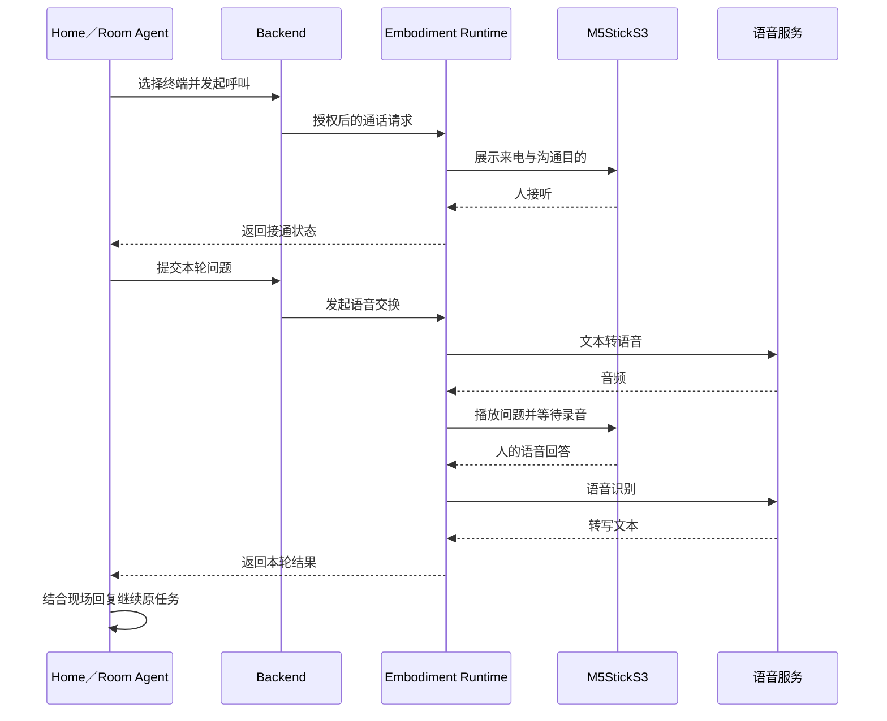

返回 Agent 的结果在实际通信中经 Backend 和工具调用链路传递。设备端采用 WebSocket 控制消息和 S3AU 音频帧，传输 16 kHz 单声道 PCM16LE 音频。服务端对接 Qwen TTS／ASR，固件以半双工轮次组织播放和录音。

设备通过配对码进入组织，凭据持久化后确认接收，后续支持轮换和撤销。来电拒接、设备离线、语音为空、中途断线及识别失败均有对应状态，调用 Agent 可据此继续处理。

M5StickS3 固件和 PC 模拟器共享可移植终端核心、LVGL 显示场景及协议实现，硬件适配层处理 Wi-Fi、按键、音频、显示和本地存储。这使终端交互可以先在模拟环境中验证，再通过实物补充现场体验数据。

### 部署、可观测性与交付

当前部署使用 Docker Compose 组织 Backend、Event、Embodiment、PostgreSQL、RustFS、Caddy 和遥测采集组件。Backend 容器内的 Company Runtime 使用持久化工作卷，产品数据和执行工作空间分别持久化。

桌面端采用 Electron，移动端采用 PWA，共用 React 产品界面。桌面 Shell 与应用 Runtime 具有分别发布和更新的路径，以适应界面与运行能力的迭代。Caddy 负责对外入口、静态资源与服务路由。

OpenTelemetry 将前端、Backend 和 Company Runtime 的运行信息接入观测链路。执行记录、请求标识和成员／Room 关联信息，为分析用户操作、异步执行和结果回传的问题提供定位依据。

### 主要技术选型

| 技术领域 | 当前采用的技术 | 对应职责 |
|---|---|---|
| 核心语言与运行环境 | TypeScript、Node.js | 产品服务、Company Runtime、共享契约及前端逻辑 |
| 产品接口 | Fastify、tRPC、Zod | HTTP 服务、类型化调用和运行时校验 |
| 数据持久化 | PostgreSQL、Drizzle ORM | 产品状态、事务、执行记录与事件投递 |
| 文件与能力资产 | RustFS、S3 兼容接口 | 文件内容、不可变资产包及受控访问 |
| 异步处理 | Transactional Outbox、Event Worker、Inbox | 持久化事件、派发、重试与去重 |
| Agent 执行 | Codex App Server、MCP | 成员执行环境及产品工具接入 |
| 产品界面 | React、Electron、PWA | 桌面和移动协作体验 |
| 物理终端 | M5StickS3、Arduino C++、LVGL、WebSocket | 实体语音端点、显示与按键交互 |
| 语音能力 | Qwen TTS／ASR、PCM 音频传输 | Agent 问题播放及现场回答转写 |
| 部署与观测 | Docker Compose、Caddy、OpenTelemetry | 服务交付、统一接入及运行诊断 |

### 架构设计与产品价值的对应

| 架构决策 | 解决的工程问题 | 支撑的产品亮点 |
|---|---|---|
| 产品服务与执行 Runtime 分离 | 长时执行、工具调用和产品状态有不同生命周期 | 团队协作可以持续，Agent 能力可独立维护 |
| Agent 身份与执行器绑定分别管理 | 稳定角色与变化中的执行能力需要分别演进 | 同一协作成员持续承担工作 |
| 文件版本与执行快照 | 多人编辑和长时执行可能使用不同资料 | 用户能够识别工作依据和来源版本 |
| 持久化事件与完成回传 | 网络和进程中断会打断异步执行链路 | 结果可恢复并回到原协作语境 |
| 成员工作空间与授权工具 | 多成员执行需要隔离并共享必要资料 | 私有工作与团队上下文有明确关系 |
| 物理终端作为 Agent 工具能力 | 现实中的回答需要进入数字任务 | Agent 可以主动获取现场输入并继续工作 |
| 共享契约与终端核心复用 | 多端和多进程需要保持交互一致 | 桌面、移动和物理端点承接连续体验 |

## 验证与演进

### 核心体验验证

| 编号 | 场景 | 应观察到的结果 |
|---|---|---|
| A01 | 创建 Room 并组织人类和 Agent | 所有参与者能够进入正确空间并理解角色 |
| A02 | 共享资料后发起一次 Agent 工作 | 资料、触发消息和执行结果保持关联 |
| A03 | 第二位人类成员接手续写或修订 | 能够理解背景并继续使用已有产物 |
| A04 | 两个 Agent 接续处理同一问题 | 前序结果可被引用，各成员贡献可识别 |
| A05 | 工作中补充资料或改变要求 | 后续执行能够采用新的输入，并保持变化可理解 |
| A06 | 执行失败、重连或中断 | 已有状态可恢复，后续处理路径明确 |
| A07 | Agent 呼叫实体终端并获得回答 | 完成语音往返，回复进入原任务 |
| A08 | 物理通话拒接、离线或中断 | 原任务显示待处理输入，用户可继续处理 |
| A09 | 跨端继续同一讨论 | 消息、成员身份和引用关系保持一致 |
| A10 | 另一项目复用已有资料与能力 | 产生可观察的实际复用，并记录配置成本 |

### 产品演进路径

| 阶段 | 重点 | 进入下一阶段的依据 |
|---|---|---|
| 核心体验形成 | 确认 Room 协作、Agent 身份和物理语音往返的交互 | 核心交互连贯，端到端场景可以演示 |
| 真实项目试用 | 让目标团队将一项真实工作放入产品 | 完成价值事件，出现接续使用，并收集失败与放弃原因 |
| 重复使用验证 | 观察同一团队的后续任务和相似项目 | 持续使用、跨成员接续与资产复用形成记录 |
| 扩展能力 | 依据真实需求完善 Cell Kit、更多执行器和设备接入 | 需求频率、交付价值和维护成本能够支撑投入 |

## 团队采用与反馈

AI 原生团队可以直接用 Fields 承接已有项目。传统公司可以从一个具体业务场景开始，由实施服务帮助完成流程梳理、角色配置和首次运行，再根据使用情况扩大采用。

产品验证应重点回答用户是否愿意持续把工作放进 Fields、是否愿意为重复使用付费，以及同一客户是否出现第二个项目或团队采用。

早期反馈围绕以下问题采集。

- 用户在哪一步感受到明确价值，在哪一步放弃。
- 哪些背景需要反复解释，哪些产物难以接手。
- Agent 的自动参与在哪些情境有帮助，在哪些情境造成打扰。
- 现场语音联系在什么任务中节省等待，在什么情境中不便接听。
- 同类工作再次发生时，哪些配置和资料真正被复用。

[返回目录](#fields-contents)
